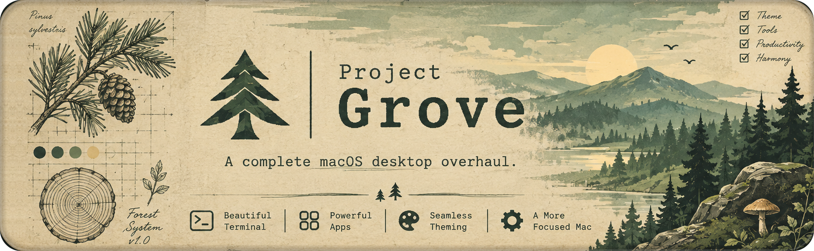

<p align="center">
  
</p>

# Project Grove

A complete macOS desktop overhaul: dotfiles, an installer, and third-party tools adapted to fit, all in the [Everforest](https://github.com/sainnhe/everforest) dark medium palette by sainnhe. JetBrains Mono for code, SF Pro for everything else. Every change is recorded, so the whole setup can be planted again on a fresh Mac.

## Start on a fresh Mac

Open Terminal and paste:

```sh
curl -fsSL https://raw.githubusercontent.com/gmarques-x/project-grove/main/grove-dotfiles/bootstrap.sh | bash
```

It clones this repo to `~/Developer/project-grove` and runs `grove install`. Read [grove-dotfiles/README.md](grove-dotfiles/README.md) first: it lists what the installer asks for and what it changes.

## What's inside

| Folder | What it is |
| --- | --- |
| [`grove-dotfiles/`](grove-dotfiles/) | The `grove` installer and every config it links into `~/.config`: Ghostty, zsh, Starship, git, SSH, bat, eza, yazi and fastfetch, plus Homebrew packages, fonts and Finder settings. |

More pieces will grow here over time.

## Credits

The colors are [Everforest](https://github.com/sainnhe/everforest) by sainnhe. Every color in the configs comes from its palette, and the tests check it.
