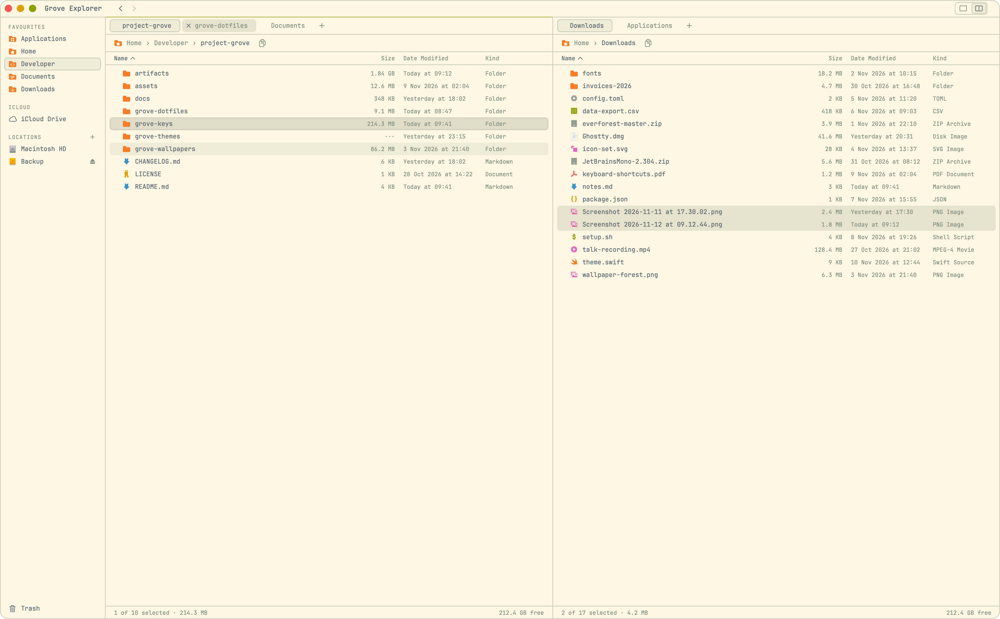
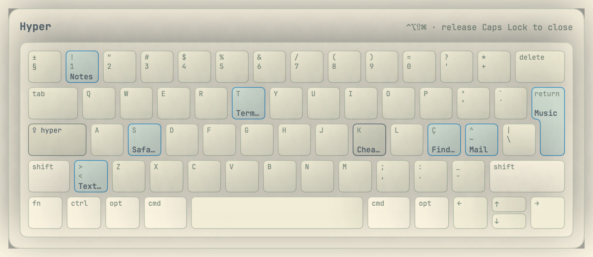
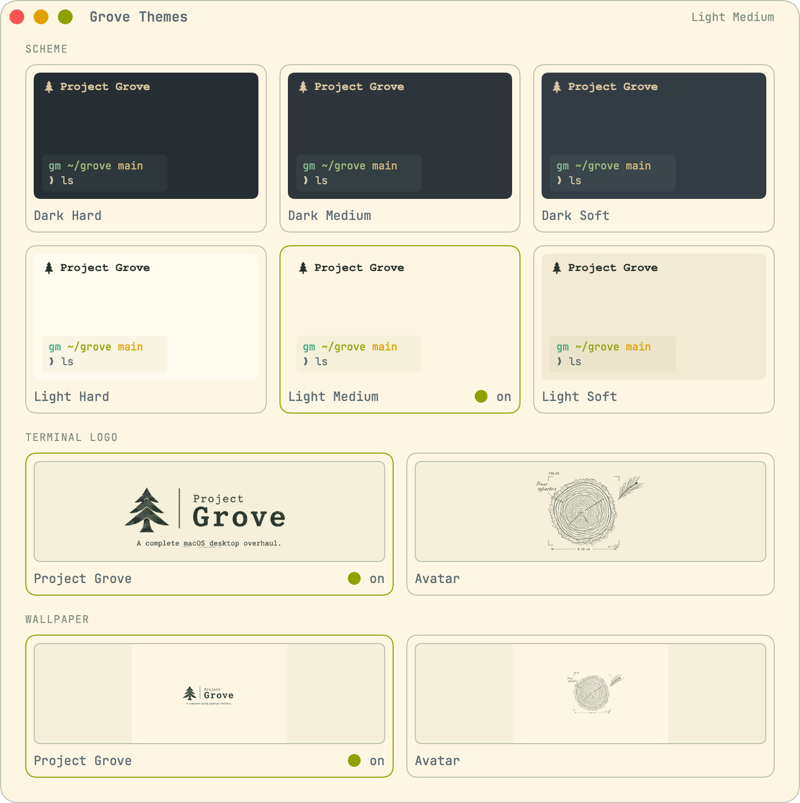

<p align="center">
  
</p>

# Project Grove

A personal macOS overhaul in the [Everforest](https://github.com/sainnhe/everforest) colours by sainnhe: a tiling desktop with its own top bar, a keyboard layer on Caps Lock, a themed terminal and editor, and one menu that reaches all of it. An installer sets the whole thing up on a fresh Mac, and a switcher moves everything between six schemes (dark or light, each in hard, medium or soft contrast).

## Screenshots

<p align="center">
  <picture>
    <source media="(prefers-color-scheme: dark)" srcset="assets/screenshots/explorer-two-panes-dark-medium.png">
    
  </picture>
  <br><em>Grove Explorer: two panes, tabs in each, Finder's keys.</em>
</p>

<p align="center">
  <picture>
    <source media="(prefers-color-scheme: dark)" srcset="assets/screenshots/keys-cheatsheet-dark-medium.png">
    
  </picture>
  <br><em>The Hyper cheat sheet from Grove Keys: hold Caps Lock to see what every key does.</em>
</p>

<p align="center">
  <picture>
    <source media="(prefers-color-scheme: dark)" srcset="assets/screenshots/themes-gallery-dark-medium.png">
    
  </picture>
  <br><em>Grove Themes: six Everforest schemes, the terminal logo and the wallpaper, one click each.</em>
</p>

The pictures follow your light or dark setting: Everforest dark medium or light medium.

## What's inside

| Folder | What it is |
| --- | --- |
| [`grove-dotfiles/`](grove-dotfiles/) | The `grove` installer and every config it manages: the tiling desktop (AeroSpace, with JankyBorders), the Grove bar (SketchyBar, in place of the menu bar), the Grove menu, the terminal (Ghostty, zsh, Starship, Yazi, fastfetch), VS Code and Chrome themes, git and SSH, fonts and Finder settings, and [grove](grove-dotfiles/config/grove-claude/grove/), a mod for Claude Code. It also builds and installs the three apps below. |
| [`grove-keys/`](grove-keys/) | Grove Keys, the keyboard app: Caps Lock as a Hyper key, app launchers, the window-manager shortcuts, a cheat sheet, and the menus behind the bar (the Grove menu, the Grove Launcher on ⌘Space and each app's own menus). |
| [`grove-explorer/`](grove-explorer/) | Grove Explorer, the file browser: one pane or two with tabs in each, Finder's keys, copying and moving with undo, and Grove Icons. |
| [`grove-themes/`](grove-themes/) | The `grove-themes` command and the Grove Themes app: switch the desktop between the six Everforest schemes, and choose the terminal logo and wallpaper. |
| [`grove-wallpapers/`](grove-wallpapers/) | Two wallpapers for each scheme, 2880 × 1864: the Project Grove lockup and the avatar drawing. |
| [`assets/`](assets/) | Images for this page. |

## The manual

[**docs/manual**](docs/manual/README.md) says what to press: the desktop and the bar, the Grove menu, themes, hotkeys, the terminal, [files](docs/manual/09-files.md), updating and undoing, and a table for people [coming from stock macOS](docs/manual/08-coming-from-stock-macos.md).

## What it changes on your Mac

Read this before you paste anything. Grove is a whole setup, and it is not undone with one command.

- **`~/.config` becomes a link into this repo** (`grove-dotfiles/config`). An existing `~/.config` is not thrown away: its contents are moved into that folder, and any file that clashes with one Grove ships is moved to `~/.local/state/grove/backup/` instead. Afterwards, deleting the repo deletes your `~/.config`.
- `~/.zshrc`, `~/.zprofile` and `~/.gitconfig` are moved to the same backup folder; `~/.zshenv` and `~/.ssh/config` become links.
- The macOS menu bar is hidden behind the Grove bar, windows are tiled, and Caps Lock becomes a Hyper key. Menu-bar icons from other apps move into a tray in the Grove bar.
- Homebrew packages, fonts, two apps that start at login and a file browser, a code-signing certificate in your keychain, an SSH key and a GitHub sign-in, and Finder, Dock and appearance settings.
- If Claude Code is installed, the grove mod is added to it as a plugin (an Agents pane, a status line and colours that follow the scheme). Claude Code records this in `~/.claude/settings.json`.

The full list, what the installer asks for, and how to take it all back are in the manual: [Getting started](docs/manual/01-getting-started.md) and [Updates and undo](docs/manual/07-updates-and-undo.md).

## Start on a fresh Mac

Open Terminal and paste:

```sh
curl -fsSL https://raw.githubusercontent.com/gmarques-x/project-grove/main/grove-dotfiles/bootstrap.sh | bash
```

It clones this repo to `~/Developer/project-grove` and runs `grove install`.

## Credits

The colours are [Everforest](https://github.com/sainnhe/everforest) by sainnhe. Every colour in the configs comes from its palette, and the tests check it.

## Licence

[MIT](LICENSE).
