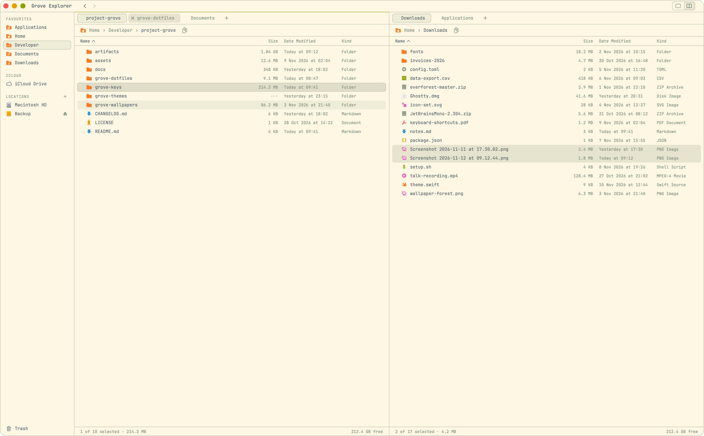
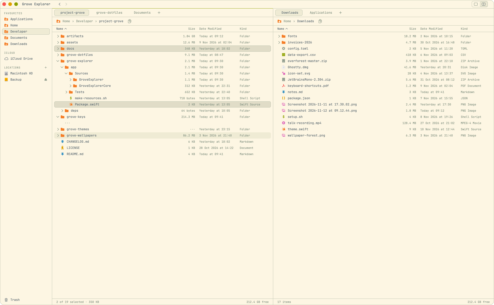

# Grove Explorer

The file browser of Project Grove.

It shows a folder as a list, in one pane or two with tabs in each, answers Finder's keys, opens folders in place as a tree, copies and moves between panes with undo, connects to shared folders, and draws every file with Grove Icons in the current scheme. Finder stays installed and unchanged beside it.

How to use it is in the manual: [Files](../docs/manual/09-files.md). This page is about how it is put together.

<p align="center">
  <picture>
    <source media="(prefers-color-scheme: dark)" srcset="../assets/screenshots/explorer-two-panes-dark-medium.png">
    
  </picture>
  <br><em>Two panes, tabs in each: Tab moves between them, F5 copies and F6 moves across.</em>
</p>

<p align="center">
  <picture>
    <source media="(prefers-color-scheme: dark)" srcset="../assets/screenshots/explorer-tree-dark-medium.png">
    
  </picture>
  <br><em>Folders open in place: → opens one, ⌥→ opens everything inside it.</em>
</p>

## Reaching it

It is an ordinary app, `~/Applications/Grove Explorer.app`: it is in ⌘Tab, it does not start at login, and closing its window quits it. Open it from the pine (Files), from the Grove Launcher (⌘Space, then `files`), or with `open -a 'Grove Explorer'`.

A link opens a folder too, which also works from a terminal:

| Link | What it does |
| --- | --- |
| `groveexplorer://open?path=<path>` | Opens that folder in a new tab and brings the window forward; a file's path opens its folder with the file selected. The path is percent-encoded (a space is `%20`) |

The Grove bar's cloud panel uses it for Open in Grove Explorer.

## The files

Settings are in `~/.config/grove-explorer/explorer.toml` (tracked as `grove-dotfiles/config/grove-explorer/explorer.toml`: Grove's defaults, replaced by updates) and `explorer.local.toml` beside it (yours, untracked). The local file holds your favourites, written for you when you add or remove one in the sidebar, and the shared folders you keep, as `[servers.…]` tables with their `url` and never a password. A mistake in either file shows as an orange line at the top of the window.

The window's panes, tabs, folders and sort orders are kept in `$GROVE_STATE/explorer-session.json` and come back when it opens.

The icons are Grove Icons, the same font and map as the VS Code theme (`grove-dotfiles/config/vscode/grove-icons`). They are copied into the app by `app/make-resources.sh`, into a folder git ignores; the build stops and says so when they are missing.

Design: `grove-dotfiles/docs/specs/2026-11-12-grove-explorer-design.md`, and `2026-11-13-grove-explorer-shared-folders-design.md` in the same folder.

## Install

```
grove install explorer-app
```

Module `94-explorer-app` copies the icons, builds the app with `swift` (Command Line Tools are enough), signs it with the Grove Code Signing certificate that Grove Keys uses (made here if it isn't there yet), and installs `~/Applications/Grove Explorer.app` (`com.projectgrove.explorer`). It never opens or quits the app. A stamp inside the bundle records what it was built from, so `grove check` notices when the source of the app, or of `grove-themes/app` which it depends on, changed.

The signature matters for the same reason as Grove Keys': macOS ties the folders you allowed to the app's signature, and a certificate signature stays the same across rebuilds.

## Permissions

Grove Explorer asks for no permission up front. macOS asks once for each protected place the first time you open it (Desktop, Documents, Downloads, iCloud Drive, a disk you plug in, a network disk), and the first ⌘I asks whether Grove Explorer may control Finder, which shows Get Info. Items in iCloud Drive and other cloud folders go to the Trash through Finder, so the first ⌘⌫ there asks whether Grove Explorer may control Finder, if ⌘I hasn't asked already. A refused folder says which permission is missing, with a button for Privacy Settings. It does not ask for Full Disk Access.

## The package

`app/` is a Swift package. `GroveExplorerCore` holds what has no views (reading folders, sorting, filtering, the tree, the copy and move queue with conflicts and undo, the session, the config, shared folders) and is what the tests cover; `GroveExplorer` is the SwiftUI and AppKit app. Both build on `GroveThemesCore` and `GroveUI` from [Grove Themes](../grove-themes/README.md) through `deps/grove-themes`.

## Tests

```
cd grove-explorer/app && ./make-resources.sh && swift test     the Swift package
cd grove-dotfiles && bats tests/modules_explorer_app.bats      the grove module
```
